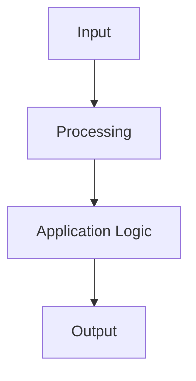

# Project Documentation Template

**Document ID:** FCL-TPL-001  
**Version:** 2.0  
**Status:** Draft for Maintainer Review  
**Effective Date:** Pending approval  
**Maintainer:** J-ART  
**Repository:** Framing Creativity Lab  
**Template Type:** Project Documentation

---

## About This Template

This template provides a consistent, proportionate structure for documenting projects developed, researched, experimented with, or maintained within Framing Creativity Lab.

It is intended to make a project's purpose, scope, current state, evidence, technical approach, limitations, risks, and publication conditions understandable and traceable. It can be adapted for research investigations, AI experiments, creative technology, software, developer tools, prototypes, digital experiences, and other technical or creative work.

The template is deliberately modular. Complete the sections relevant to the project, retain important sections when the answer is "not assessed" or "not applicable", and avoid adding detail that does not improve understanding or accountability.

### How to use this template

1. Copy this file into the project's documentation directory and give the resulting file an appropriate name, normally `PROJECT.md`.
2. Replace every instructional placeholder with accurate project-specific information.
3. Keep the six governance fields in Section 4 separate. Do not substitute one taxonomy for another.
4. Complete conditional sections when the relevant technology, data, interface, research activity, or operational context applies.
5. Remove only genuinely irrelevant optional subsections; do not remove a control merely because it has not yet been completed.
6. Update the record when the project's scope, status, evidence, risks, or publication conditions materially change.
7. Review the completed document for accuracy and confidentiality before publishing it.

Do not publish a document containing unresolved placeholders, unsupported claims, secrets, credentials, private personal information, confidential material, or restricted implementation details. The project record must not be used to move restricted work into the public Lab environment.

---

# [PROJECT NAME]

> [Write a concise description of the project, its purpose, and the outcome it is currently intended to produce.]

**Project ID:** [Identifier, if assigned]  
**Lifecycle Stage:** [One canonical stage from Section 4]  
**Project Status:** [One canonical status from Section 4]  
**Technical Maturity:** [Not Assessed / Exploratory / Prototype / Validated]  
**Operational Readiness:** [Not Assessed / Research or Experimental Use Only / Demonstration Only / Limited Operational Use / Production-Oriented]  
**Publication Classification:** [P0 / P1 / P2 / P3]  
**Publication Status:** [PENDING / APPROVED / REJECTED / WITHDRAWN]  
**Project Category:** [Research / AI / Software / Creative Technology / Digital Experience / Tool / Other]  
**Project Version:** [Version or identifier]  
**Created:** [YYYY-MM-DD]  
**Last Updated:** [YYYY-MM-DD]  
**Maintainer:** [Person or role]  
**Repository:** [URL, if public and approved]

---

## 1. Project Summary

### 1.1 Purpose

[Explain why the project exists and what it is intended to investigate, create, or improve.]

### 1.2 Context and Motivation

[Describe the problem, opportunity, research question, technical limitation, or creative intention that led to the project.]

### 1.3 Core Concept

[Explain the central idea, mechanism, or approach in language that an informed reader can understand.]

### 1.4 Relevance to the Lab

[Explain how the project relates to the Lab's mission and research domains. Identify its primary orientation: exploratory, research-led, technical, creative, or application-focused.]

### 1.5 Current Outcome

[Describe what exists today. Separate implemented capabilities from intended or speculative future work.]

---

## 2. Objectives and Success Criteria

### 2.1 Primary Objective

[State the principal objective in a way that can be evaluated.]

### 2.2 Secondary Objectives

- [Objective]
- [Objective]
- [Objective]

### 2.3 Research Questions and Hypotheses

[Complete when the project involves structured research or experimentation. Distinguish evidence-backed assumptions from hypotheses that remain untested.]

| ID | Question or hypothesis | Current evidence | Evaluation method | State |
|---|---|---|---|---|
| Q-01 | [Description] | [Evidence or none] | [Method] | [Untested / Under evaluation / Supported / Rejected] |
| Q-02 | [Description] | [Evidence or none] | [Method] | [Untested / Under evaluation / Supported / Rejected] |

### 2.4 Success Criteria

[Define what would count as a successful outcome. Use measurable criteria where meaningful; for qualitative or creative outcomes, state the evaluation approach.]

| Criterion | Expected result | Evaluation method | Priority |
|---|---|---|---|
| [Criterion] | [Target or expected quality] | [Method] | [High / Medium / Low] |
| [Criterion] | [Target or expected quality] | [Method] | [High / Medium / Low] |

### 2.5 Expected Deliverables

[Identify intended outputs. Mark each as planned, in progress, or complete. Do not describe an intended deliverable as an existing capability.]

| Deliverable | Description | Format | State |
|---|---|---|---|
| [Deliverable] | [Description] | [Code / Report / Prototype / Tool / Experience / Other] | [Planned / In Progress / Complete] |

---

## 3. Scope, Audience, and Boundaries

### 3.1 Included Scope

- [Included capability, research activity, or deliverable]
- [Included capability, research activity, or deliverable]

### 3.2 Excluded Scope

- [Explicit exclusion]
- [Explicit exclusion]

### 3.3 Intended Audience and Users

[Identify the intended audience or user groups, where applicable. Do not imply a target audience has been tested unless evidence exists.]

### 3.4 Intended Use Cases

| Use case | Description | Priority | Evidence or state |
|---|---|---|---|
| [Use case] | [Description] | [High / Medium / Low] | [Proposed / Tested / Validated] |

### 3.5 Unsupported or Prohibited Uses

[Identify foreseeable uses that are outside the project's intended purpose, unsupported, or not authorized. Include safety or misuse boundaries where relevant.]

### 3.6 Constraints and Assumptions

[Record material technical, methodological, legal, financial, time, resource, or external constraints. Identify assumptions that could change the project direction.]

---

## 4. Project State and Assessment Record

This section records six distinct fields. They describe different aspects of a project and must not be merged into a single maturity or status label.

### 4.1 Lifecycle Stage

Lifecycle Stage identifies the project's position in the Lab's workflow. Use one of the nine stages defined by `PROJECT-LIFECYCLE.md`:

| Stage | Canonical name |
|---|---|
| 01 | Idea and Intake |
| 02 | Proposal |
| 03 | Discovery and Feasibility |
| 04 | Experimentation and Development |
| 05 | Validation and Evaluation |
| 06 | Publication Review |
| 07 | Publication and Release |
| 08 | Maintenance and Evolution |
| 09 | Archival or Discontinuation |

**Selected Lifecycle Stage:** [One canonical name]  
**Stage Rationale:** [Briefly explain why this stage reflects the project's current workflow position.]

A lifecycle stage describes process position. It is not a project status, quality rating, or publication approval.

### 4.2 Project Status

Project Status describes the project's current state. Use one of the ten canonical values defined by `PROJECT-LIFECYCLE.md`:

| Canonical status | Definition |
|---|---|
| Proposed | An idea or project proposal awaiting evaluation |
| Concept | An early-stage concept under exploration |
| Experimental | An active experiment or technical exploration |
| Prototype | A demonstrable implementation used to evaluate an approach |
| Development | An actively evolving implementation |
| Validation | A project undergoing structured testing or evaluation |
| Published | An approved project or result available publicly |
| Maintenance | A published project receiving ongoing updates |
| Archived | A project retained for reference without active development |
| Discontinued | A project formally closed and no longer intended for development |

**Selected Project Status:** [One canonical status]  
**Status Rationale:** [Briefly explain the current state of the work.]

Do not infer Project Status solely from Lifecycle Stage. Select the status that best describes actual project activity and state.

### 4.3 Technical Maturity

Technical Maturity describes the level of technical evidence and validation. Use one of the four values governed by `QUALITY-STANDARDS.md`:

| Value | Meaning |
|---|---|
| Not Assessed | Technical maturity has not yet been formally assessed or recorded. |
| Exploratory | The work is investigating an approach; implementation or evidence may be incomplete and conclusions remain provisional. |
| Prototype | A demonstrable implementation exists to explore or evaluate an approach; it is not, by this label alone, validated or operationally ready. |
| Validated | The declared technical objectives have been evaluated against documented criteria, with supporting evidence and limitations recorded. |

**Selected Technical Maturity:** [Not Assessed / Exploratory / Prototype / Validated]  
**Assessment Date:** [YYYY-MM-DD or Not Assessed]  
**Evidence Reference:** [Tests, report, experiment record, or Not Available]

Technical Maturity is an evidence-based assessment. It does not establish production readiness or publication permission.

### 4.4 Operational Readiness

Operational Readiness describes the intended and assessed context in which the project can be used. Use one of the five values governed by `QUALITY-STANDARDS.md`:

| Value | Meaning |
|---|---|
| Not Assessed | Operational readiness has not yet been formally assessed or recorded. |
| Research or Experimental Use Only | Use is limited to research, development, or controlled experimentation. |
| Demonstration Only | The project can be shown or demonstrated under defined conditions but is not approved for general operational use. |
| Limited Operational Use | The project may be used in a defined, constrained context with documented limitations, controls, and oversight. |
| Production-Oriented | The project has been designed and assessed with sustained operational use in view; this label is not a certification or guarantee of production suitability. |

**Selected Operational Readiness:** [One canonical value]  
**Assessment Date:** [YYYY-MM-DD or Not Assessed]  
**Conditions and Limitations:** [State controls, oversight, environment, and limitations; or Not Assessed]

Operational Readiness is not interchangeable with Technical Maturity. A technically validated project may still be unsuitable for operational use.

### 4.5 Publication Classification

Publication Classification identifies the level of publication scrutiny required. Use the levels defined by `PUBLICATION-POLICY.md`:

| Level | Canonical classification | Meaning |
|---|---|---|
| P0 | Public-ready | Independent, low-risk material with established publication rights. |
| P1 | Controlled publication | Material requiring additional checks because of dependencies, external services, data, or technical exposure. |
| P2 | Restricted review | Material presenting unresolved ownership, security, privacy, or confidentiality questions. |
| P3 | Non-publishable | Material that must not enter the public Lab environment. |

**Selected Publication Classification:** [P0 / P1 / P2 / P3]  
**Classification Rationale:** [Summarize the basis without disclosing restricted details.]  
**Review Reference:** [Record or Not Available]

P2 and P3 material must not be placed in the public repository. P1 requires the additional checks and conditions established by `PUBLICATION-POLICY.md`. Classification is not publication approval.

### 4.6 Publication Status

Publication Status records the current review state or final publication decision. Use only the four canonical values defined by `PUBLICATION-POLICY.md`:

| Value | Meaning |
|---|---|
| PENDING | Publication review or a required decision is pending. |
| APPROVED | The defined publication scope has been approved. |
| REJECTED | The proposed publication has been rejected. |
| WITHDRAWN | A previously proposed or approved publication has been withdrawn. |

**Selected Publication Status:** [PENDING / APPROVED / REJECTED / WITHDRAWN]  
**Decision Date:** [YYYY-MM-DD or Pending]  
**Approving Authority:** [Maintainer or delegated role, where applicable]  
**Approved Scope or Decision Reference:** [Reference or Not Available]

PENDING is a review state, not an approval. APPROVED applies only to the scope that was reviewed. Do not infer Publication Status from Project Status, Technical Maturity, Operational Readiness, or Publication Classification.

### 4.7 Assessment Review

[Record who reviewed the fields above, when they were reviewed, and what needs reassessment. Use Not Assessed where no review has taken place.]

| Field | Last reviewed | Reviewer | Reassessment trigger or note |
|---|---|---|---|
| Lifecycle Stage | [Date] | [Role] | [Note] |
| Project Status | [Date] | [Role] | [Note] |
| Technical Maturity | [Date / Not Assessed] | [Role] | [Note] |
| Operational Readiness | [Date / Not Assessed] | [Role] | [Note] |
| Publication Classification | [Date] | [Role] | [Note] |
| Publication Status | [Date] | [Role] | [Note] |

---

## 5. Project Structure and Deliverables

### 5.1 Repository Structure

[Show the actual, current project structure. Keep the example below only as a guide.]

```text
project-name/
├── README.md
├── PROJECT.md
├── docs/
├── src/
├── tests/
├── examples/
├── assets/
└── scripts/
```

### 5.2 Main Components

| Component | Responsibility | Dependencies or interfaces |
|---|---|---|
| [Component] | [Description] | [Dependencies] |

### 5.3 Deliverable Acceptance

[State the conditions that must be met before each principal deliverable is considered complete. Refer to test records or review evidence where possible.]

---

## 6. Research and Methodology

[Complete when the project involves research, experimentation, technical investigation, or structured evaluation.]

### 6.1 Approach and Method

[Describe the research approach and explain how the investigation is conducted.]

### 6.2 Experimental Design

| Element | Description |
|---|---|
| Objective | [What is being investigated] |
| Hypothesis | [Expected result, if applicable] |
| Variables or factors | [What is changed or compared] |
| Baseline | [Reference point, if applicable] |
| Inputs and sources | [Inputs, datasets, or materials] |
| Evaluation method | [How results are assessed] |
| Reproducibility conditions | [Environment, versions, parameters, or constraints] |

### 6.3 Evidence and Results

[Summarize observed results. Distinguish measurements and observations from interpretations or hypotheses. Link to detailed experiment records where they exist.]

### 6.4 Sources and Limitations

[List relevant publications, documentation, datasets, and technical references. Record methodological limitations, incomplete evidence, sampling constraints, and assumptions affecting interpretation.]

### 6.5 Research Contribution

[Explain the knowledge, method, finding, or technical understanding the project contributes, if established.]

---

## 7. Technical Architecture

### 7.1 Architecture Overview

[Explain the system structure and the responsibility of its main parts.]

### 7.2 Architecture Diagram

[Insert or link to a diagram that reflects the actual implementation.]



*Illustrative only. Replace with the actual architecture or remove this example.*

### 7.3 Data and Control Flow

[Explain how information and control move through the system, including important transformations, storage points, and external boundaries.]

### 7.4 Interfaces and Integrations

| Interface or integration | Purpose | Direction | Dependency |
|---|---|---|---|
| [Name] | [Purpose] | [Input / Output / Bidirectional] | [Internal / External] |

### 7.5 Material Architecture Decisions

[Summarize important decisions and link to Architecture Decision Records where maintained.]

| ID | Decision | Rationale | Date or reference |
|---|---|---|---|
| ADR-001 | [Decision] | [Rationale] | [Date or link] |

### 7.6 Known Architecture Limitations

[Document significant design compromises, coupling, scalability constraints, or unresolved architecture risks.]

---

## 8. Technology, Environment, and Dependencies

### 8.1 Technology Stack

| Technology | Version | Purpose | Reference |
|---|---|---|---|
| [Language / framework / database / service] | [Version] | [Purpose] | [Documentation URL] |

### 8.2 Development and Runtime Environment

[Record supported operating systems, language runtimes, hardware assumptions, database requirements, and other environment details necessary to understand or reproduce the project.]

### 8.3 Dependency Management

[Explain how dependencies are declared, installed, updated, and checked. Identify significant licensing or compatibility constraints.]

### 8.4 Infrastructure and External Services

[Describe relevant hosting, storage, deployment, APIs, model providers, and other external services at a level appropriate for the intended audience. Do not disclose private infrastructure details, endpoints, credentials, or internal access paths.]

### 8.5 Resource and Cost Considerations

[Document meaningful compute, memory, storage, network, API, or recurring-cost requirements. Do not include private billing information.]

---

## 9. Artificial Intelligence and Model Information

[Complete when AI or machine learning contributes materially to the project.]

### 9.1 AI Functionality and Role

[Explain where AI is used and whether it supports generation, classification, retrieval, prediction, recommendation, automation, reasoning assistance, or another function.]

### 9.2 Models and Providers

| Model or service | Provider or source | Version or identifier | Role |
|---|---|---|---|
| [Model] | [Provider] | [Version / identifier] | [Purpose] |

### 9.3 Configuration and Instruction Management

[Document relevant configuration, parameters, prompt management, retrieval settings, and versioning practices when publication is authorized. Do not disclose private instructions, secrets, confidential provider information, or restricted implementation details.]

### 9.4 Data Sources and Rights

[Identify relevant model inputs, retrieval sources, datasets, and applicable use rights or restrictions.]

### 9.5 Behavior, Limitations, and Human Oversight

[Describe known limitations, variability, failure modes, hallucination risks, and the role of human review or intervention.]

### 9.6 Evaluation

| Criterion | Evaluation method | Result or evidence | State |
|---|---|---|---|
| [Accuracy or task performance] | [Method] | [Result / reference] | [Not Tested / Pass / Partial / Fail] |
| [Reliability or robustness] | [Method] | [Result / reference] | [Not Tested / Pass / Partial / Fail] |

### 9.7 AI Risk Assessment

**Risk Level:** [Applicable level under `RESPONSIBLE-AI.md`]  
**Assessment Date:** [YYYY-MM-DD or Not Assessed]  
**Assessment Reference:** [Link or record]

[Summarize the relevant risks and controls without exposing restricted information. Refer to `RESPONSIBLE-AI.md` for the Lab's governing principles and assessment framework.]

---

## 10. Data Management

[Complete when the project collects, stores, processes, transforms, or retrieves data.]

### 10.1 Data Sources and Rights

| Source | Data type | Origin | Rights or permitted use |
|---|---|---|---|
| [Source] | [Type] | [Origin] | [Rights / licence / restrictions] |

### 10.2 Data Classification

[Record the applicable classification using the Lab's relevant data-handling requirements. Where several types of data are present, identify the most restrictive applicable handling requirement.]

### 10.3 Processing and Storage

[Describe collection, validation, transformation, storage, retention, deletion, and access arrangements at a level safe for the intended publication.]

### 10.4 Data Protection and Limitations

[Describe relevant access restrictions, minimisation, anonymisation or pseudonymisation, safeguards, data quality issues, bias, sampling limitations, and restrictions on reuse.]

---

## 11. Security and Privacy

### 11.1 Security Considerations

[Describe relevant security boundaries and protections. Consider authentication, authorization, input validation, secret management, dependency security, file handling, external integrations, tool permissions, logging, and monitoring as applicable.]

### 11.2 Privacy Considerations

[Identify whether personal or sensitive information is involved and summarize the applicable privacy safeguards and requirements.]

### 11.3 Risk Register

| Risk | Potential impact | Likelihood | Mitigation or control | State |
|---|---|---|---|---|
| [Risk] | [Impact] | [Low / Medium / High] | [Control] | [Open / Mitigated / Accepted] |

### 11.4 Review and Known Limitations

**Security Review:** [Not Started / In Progress / Completed / Not Applicable]  
**Last Review:** [YYYY-MM-DD or Not Assessed]  
**Reviewer:** [Person or role]

[Describe unresolved issues or unassessed areas without disclosing exploitable vulnerability details. Refer to `SECURITY.md` for reporting and handling requirements.]

---

## 12. Quality Assurance and Validation

### 12.1 Quality Approach

[Describe how quality is assessed in proportion to the project's scope, risks, and intended use. Refer to `QUALITY-STANDARDS.md` for the Lab's quality requirements.]

### 12.2 Applicable Test Types

- [ ] Unit testing
- [ ] Integration testing
- [ ] System or end-to-end testing
- [ ] Regression testing
- [ ] Performance testing
- [ ] Security testing
- [ ] Accessibility testing
- [ ] AI behavior evaluation
- [ ] Research or reproducibility review
- [ ] Manual review
- [ ] Other: [Specify]

### 12.3 Test Environment and Results

[Describe the environment and relevant versions used for validation. Link to complete test reports or retain the concise summary below.]

| Test or check | Expected result | Observed result | State | Evidence reference |
|---|---|---|---|---|
| [Test] | [Expected] | [Observed] | [Pass / Partial / Fail / Not Tested] | [Reference] |

### 12.4 Known Issues and Limitations

| Issue | Impact or severity | Workaround | State |
|---|---|---|---|
| [Issue] | [Low / Medium / High / Critical] | [Workaround or none] | [Open / Resolved] |

### 12.5 Validation Summary

[State what has been evaluated, what remains unverified, and which limitations materially affect the project's declared Technical Maturity or Operational Readiness. Do not use "Validated" without supporting evidence.]

---

## 13. User Experience, Accessibility, and Performance

[Complete the relevant subsections for user-facing, interactive, or performance-sensitive projects.]

### 13.1 Experience and Interaction

[Describe user experience objectives, main workflows, interaction model, navigation, and important interface behavior.]

### 13.2 Design System and Interface Structure

[Identify relevant components, design principles, visual conventions, and interface architecture where applicable.]

### 13.3 Accessibility and Responsive Behavior

[Describe accessibility requirements, supported interaction methods, responsive behavior, and evaluation performed.]

### 13.4 Performance Measurements

| Metric | Target or expectation | Observed result | Test conditions |
|---|---|---|---|
| [Metric] | [Target] | [Result] | [Environment and method] |

### 13.5 Known Experience or Performance Limitations

[Document important usability, accessibility, compatibility, or performance limitations.]

---

## 14. Development, Installation, and Reproducibility

### 14.1 Development Workflow

[Summarize the development process and refer to `CONTRIBUTING.md` for general Lab contribution requirements. State project-specific requirements only where needed.]

### 14.2 Installation and Execution

[Provide tested commands for installation, configuration, development, testing, and execution. Remove any command that has not been verified.]

```bash
# Replace with commands verified for this project.
# git clone [public repository URL]
# cd [project directory]
# [install command]
# [run command]
```

### 14.3 Configuration

[Document required configuration keys using placeholders only. Never include actual secrets, tokens, passwords, private endpoints, or production credentials.]

```env
# Illustrative placeholders only.
APP_ENV=[environment]
APP_PORT=[port]
API_BASE_URL=[approved public or generic endpoint]
API_KEY=[set locally; do not commit]
```

### 14.4 Build, Test, and Deployment Commands

| Command | Purpose | Verified on |
|---|---|---|
| `[command]` | [Purpose] | [Environment / date] |

### 14.5 Reproducibility

[Record version constraints, configuration assumptions, seeds, datasets, model identifiers, environment details, or other information needed to reproduce material results, subject to publication and confidentiality restrictions.]

---

## 15. Milestones and Roadmap

### 15.1 Milestones

| Milestone | Intended outcome | Target date | State |
|---|---|---|---|
| [Milestone] | [Outcome] | [YYYY-MM-DD / Unscheduled] | [Planned / In Progress / Complete] |

### 15.2 Current Priorities

1. [Priority]
2. [Priority]
3. [Priority]

### 15.3 Future Directions

[Describe possible future directions. Distinguish exploratory possibilities from approved or committed work.]

---

## 16. Risks and External Dependencies

### 16.1 Principal Project Risks

[Summarize the most material project risks and their treatment. Avoid duplicating detailed security or data risk records where a reference is sufficient.]

### 16.2 External Dependencies

[Identify APIs, model providers, cloud services, datasets, third-party platforms, libraries, or other external dependencies that could affect continuity.]

### 16.3 Dependency and Continuity Risks

[Explain material risks such as provider changes, service outages, licensing restrictions, cost increases, compatibility changes, or discontinuation.]

### 16.4 Mitigation and Contingency

[Describe proportionate mitigation, replacement, fallback, or shutdown measures.]

---

## 17. Intellectual Property, Licensing, and Attribution

### 17.1 Ownership and Authorization

[Distinguish original work, third-party material, and contributed work. Record the basis for using and distributing relevant materials.]

### 17.2 Third-Party Components and Assets

| Component or asset | Source | Licence or terms | Attribution or restriction |
|---|---|---|---|
| [Item] | [Source] | [Licence / terms] | [Requirement] |

### 17.3 Project Licence and Distribution Terms

**Project Licence:** [Applicable licence / No general licence / Other]  
**Reference:** [Licence file, terms, or Not Applicable]

[State only terms that have been verified and authorized. Do not imply that the Lab's general repository has a licence where none has been granted.]

### 17.4 Contributions and AI-Assisted Material

[Describe relevant attribution, permissions, agreements, and AI-assisted or AI-generated material where applicable. Refer to governing Lab policies and project-specific agreements.]

### 17.5 Publication Restrictions

[Identify restrictions that affect the material intended for release. Do not reproduce confidential details in this public-facing record.]

---

## 18. Publication and Distribution

This section records the project's publication scope and release information. Publication Classification and Publication Status must follow Section 4 and `PUBLICATION-POLICY.md`.

### 18.1 Publication Scope

[Identify the exact materials proposed for publication: source code, documentation, report, prototype, demonstration, assets, or other deliverables.]

### 18.2 Review and Decision Record

**Publication Classification:** [P0 / P1 / P2 / P3]  
**Publication Status:** [PENDING / APPROVED / REJECTED / WITHDRAWN]  
**Review Date:** [YYYY-MM-DD or Pending]  
**Decision Authority:** [Maintainer or delegated role]  
**Review Reference:** [Record or Not Available]

[Summarize the outcome and any conditions. For P1, record the additional checks required and their completion. Do not publish restricted details.]

### 18.3 Public Release Information

[Complete only after approval and release.]

| Release | Date | Summary | Public reference |
|---|---|---|---|
| [Version] | [YYYY-MM-DD] | [What was released] | [URL] |

### 18.4 Release Limitations

[State what the release does not include, support, or guarantee. Ensure public claims match the actual release.]

### 18.5 Withdrawal or Change of Scope

[Record a withdrawal, material change, or superseding release where applicable. Follow `PUBLICATION-POLICY.md`.]

---

## 19. Maintenance and Support

### 19.1 Maintenance Arrangement

[Identify the maintainer, responsibilities, and realistic maintenance expectations. Do not promise service levels that have not been established.]

### 19.2 Maintenance Activities

[Identify applicable activities such as defect correction, security updates, dependency updates, compatibility work, documentation updates, or feature development.]

### 19.3 Support and Issue Reporting

[Provide the approved public issue or support channel, if one exists. Do not publish private reporting routes or sensitive contact information.]

### 19.4 Maintenance Limitations

[Describe support limitations, known constraints, or areas not covered by ongoing maintenance.]

### 19.5 Archival or Discontinuation Conditions

[Describe relevant conditions and refer to `PROJECT-LIFECYCLE.md` for the formal archival or discontinuation process.]

---

## 20. Progress Summary and Next Actions

### 20.1 Completed Work

- [Completed item, supported by evidence where material]
- [Completed item]

### 20.2 Work in Progress

- [Current activity]
- [Current activity]

### 20.3 Outstanding Work

- [Outstanding item]
- [Outstanding item]

### 20.4 Current Limitations and Uncertainties

[Summarize the principal constraints and unresolved questions.]

### 20.5 Recommended Next Action

[State the next concrete action and its rationale.]

---

## 21. Decision and Experiment Records

Use concise entries here and link to detailed records when they exist.

### 21.1 Decision Log

| ID | Date | Decision | Rationale | State or reference |
|---|---|---|---|---|
| DEC-001 | [YYYY-MM-DD] | [Decision] | [Reason] | [Active / Superseded / Link] |

### 21.2 Experiment Log

| ID | Date | Objective | Result summary | Evidence reference |
|---|---|---|---|---|
| EXP-001 | [YYYY-MM-DD] | [Objective] | [Observed result and concise conclusion] | [Link or record] |

---

## 22. Contributors and Acknowledgments

### 22.1 Maintainer

**Name or role:** [Name or role]  
**Responsibilities:** [Relevant responsibilities]

### 22.2 Contributors

| Contributor | Contribution | Period | Attribution reference |
|---|---|---|---|
| [Contributor] | [Contribution] | [Period] | [Link or reference] |

### 22.3 External Acknowledgments

[Acknowledge relevant contributors, tools, datasets, publications, or organizations only where the information is accurate and authorized for publication.]

---

## 23. References and Related Lab Documents

### 23.1 Technical and Research References

- [Title — author or source — URL]
- [Title — author or source — URL]

### 23.2 Related Projects and Resources

- [Project or resource — URL]

### 23.3 Applicable Lab Documents

| Document | Relationship to this project |
|---|---|
| `LAB-CHARTER.md` | Lab identity, mission, and foundational principles |
| `GOVERNANCE.md` | Decision-making, authority, and governance responsibilities |
| `PROJECT-LIFECYCLE.md` | Canonical lifecycle stages and Project Status definitions |
| `QUALITY-STANDARDS.md` | Technical Maturity, Operational Readiness, and quality expectations |
| `PUBLICATION-POLICY.md` | Publication Classification, Publication Status, and release requirements |
| `RESEARCH-METHODOLOGY.md` | Research and experimentation principles |
| `RESPONSIBLE-AI.md` | Responsible AI requirements, where applicable |
| `SECURITY.md` | Security expectations and vulnerability reporting |
| `CONTRIBUTING.md` | General contribution requirements |
| `CODE-OF-CONDUCT.md` | Conduct expectations for participation |

Include additional policies only where they apply to the project.

---

## 24. Change History

| Version | Date | Author | Description |
|---|---|---|---|
| 2.0 | [YYYY-MM-DD] | [Author] | Updated project record structure and separated canonical lifecycle, status, maturity, readiness, and publication fields. |

---

## 25. Final Project Statement

[Write a short factual statement describing the project's present purpose, current state, demonstrated value, and next direction. Do not present planned or speculative outcomes as existing capabilities.]

---

**Framing Creativity Lab**  
*Independent Research · Creative Technology · Applied AI · Experimental Design*

[Public repository URL, if approved]

**Technology provides the structure. Creativity changes what can emerge from it.**
