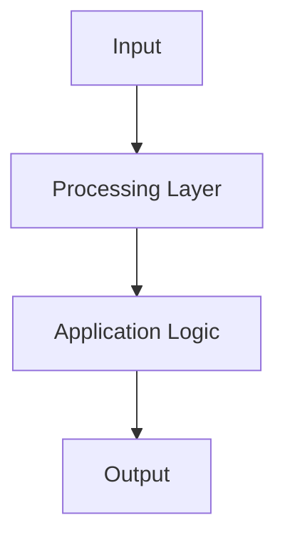

# Project Documentation Template

**Document ID:** FCL-TPL-001  
**Version:** 1.0  
**Status:** Active Template  
**Maintainer:** J-ART  
**Repository:** Framing Creativity Lab  
**Template Type:** Project Documentation

---

## About This Template

This document provides the standard structure for documenting projects developed, researched, or maintained within Framing Creativity Lab.

It is designed to provide a consistent way to describe a project's purpose, scope, architecture, development process, research activities, validation, risks, and publication status.

The template can be adapted to different project types, including:

- Artificial intelligence research and experiments.
- Creative technology projects.
- Software applications and developer tools.
- Digital product prototypes.
- Research and technical investigations.
- Interactive experiences.
- Automation and agent-based systems.
- Experimental design and multimodal projects.

### How to Use This Template

1. Create a new project directory or select the appropriate existing project directory.
2. Copy this template into that location.
3. Replace all instructional placeholders with project-specific information.
4. Remove optional sections that are genuinely not applicable.
5. Retain relevant sections even when the answer is that a feature, risk, or capability is not applicable.
6. Update the document as the project evolves.
7. Review the document before publication.

Do not leave instructional placeholders, sample values, or incomplete claims in a published project document.

**Important:** This template is intended for documentation that may become public. Do not insert private credentials, confidential project information, restricted datasets, proprietary implementation details, or personal information that is not authorized for publication.

---

# [PROJECT NAME]

> [A concise one- or two-sentence description explaining what the project is and what it aims to achieve.]

**Project ID:** [Identifier, if applicable]  
**Project Status:** [Proposed / Concept / Experimental / Prototype / Development / Validation / Published / Maintenance / Archived / Discontinued]  
**Project Category:** [AI Research / Creative Technology / Software / Digital Experience / Research / Tool / Other]  
**Quality Level:** [Exploratory / Prototype / Validated / Public Release / Production-Oriented]  
**Publication Classification:** [P0 Public-ready / P1 Controlled / P2 Restricted Review / P3 Non-publishable]  
**Version:** [Version identifier]  
**Created:** [YYYY-MM-DD]  
**Last Updated:** [YYYY-MM-DD]  
**Maintainer:** [Responsible person or role]  
**Repository:** [Repository URL, if public]

---

# 1. Project Overview

## 1.1 Description

[Provide a clear and concise description of the project.

Explain what it does, what it explores, and what makes it relevant to Framing Creativity Lab.]

## 1.2 Background and Context

[Describe the context in which the project emerged.

Explain the problem, opportunity, technical limitation, research question, or creative intention that motivated its development.]

## 1.3 Purpose

[State the primary purpose of the project.

Explain why the project exists and what it intends to accomplish.]

## 1.4 Vision

[Describe the broader direction or potential of the project.

This section may address its long-term research value, technical potential, creative contribution, or possible evolution.]

## 1.5 Core Concept

[Explain the fundamental idea behind the project.

Identify the essential principle, mechanism, or approach that defines it.]

## 1.6 Key Characteristics

- [Characteristic 1]
- [Characteristic 2]
- [Characteristic 3]
- [Characteristic 4]

## 1.7 Project Positioning

[Explain how the project relates to the Lab's mission and research domains.

Identify whether it is primarily exploratory, technical, research-oriented, creative, or application-focused.]

---

# 2. Objectives and Expected Outcomes

## 2.1 Primary Objective

[Define the main outcome the project is intended to achieve.]

## 2.2 Secondary Objectives

- [Secondary objective 1]
- [Secondary objective 2]
- [Secondary objective 3]

## 2.3 Research Questions

[For research-oriented projects, identify the questions the project intends to investigate.]

1. [Research question 1]
2. [Research question 2]
3. [Research question 3]

*Remove this subsection when the project does not involve a research question.*

## 2.4 Hypotheses and Assumptions

[Identify the hypotheses or assumptions that guide the project.

Distinguish between assumptions that are supported by existing evidence and those that still require validation.]

| ID | Hypothesis or assumption | Current evidence | Validation method | Status |
|---|---|---|---|---|
| H-01 | [Description] | [Evidence or none] | [Method] | [Untested / Testing / Supported / Rejected] |
| H-02 | [Description] | [Evidence or none] | [Method] | [Untested / Testing / Supported / Rejected] |

## 2.5 Expected Outcomes

[Describe the expected deliverables or results.]

Potential outcomes may include:

- Working software.
- A functional prototype.
- A research report.
- A technical demonstration.
- A documented methodology.
- A reusable tool or component.
- A proof of concept.
- Experimental findings.
- A creative or interactive experience.

## 2.6 Success Criteria

[Define what would constitute a successful outcome.

Use measurable criteria where meaningful. For qualitative or creative work, describe the evaluation approach and expected characteristics.]

| Criterion | Expected result | Evaluation method | Priority |
|---|---|---|---|
| [Criterion 1] | [Target] | [Method] | [High / Medium / Low] |
| [Criterion 2] | [Target] | [Method] | [High / Medium / Low] |
| [Criterion 3] | [Target] | [Method] | [High / Medium / Low] |

---

# 3. Scope and Boundaries

## 3.1 Included Scope

[Describe the functionality, research activities, technical areas, or deliverables included in the project.]

- [Included item 1]
- [Included item 2]
- [Included item 3]

## 3.2 Excluded Scope

[Explicitly identify what the project does not intend to address.]

- [Excluded item 1]
- [Excluded item 2]
- [Excluded item 3]

Clear boundaries help prevent uncontrolled expansion of project requirements.

## 3.3 Intended Users or Audience

[Identify the intended audience, if applicable.

Examples include developers, researchers, designers, creative practitioners, general users, or other specified groups.]

## 3.4 Intended Use Cases

[Describe the primary situations in which the project is expected to be used.]

| Use Case | Description | Priority | Status |
|---|---|---|---|
| [Use case 1] | [Description] | [High / Medium / Low] | [Planned / Active / Validated] |
| [Use case 2] | [Description] | [High / Medium / Low] | [Planned / Active / Validated] |

## 3.5 Out-of-Scope Uses

[Identify foreseeable uses that are not supported, authorized, or intended.

Where relevant, document restrictions on misuse, sensitive applications, or unsupported operational contexts.]

## 3.6 Constraints

[Document significant technical, operational, legal, financial, or resource constraints.]

---

# 4. Project Structure and Deliverables

## 4.1 Main Deliverables

| Deliverable | Description | Format | Status |
|---|---|---|---|
| [Deliverable 1] | [Description] | [Code / Document / Prototype / Other] | [Planned / In Progress / Complete] |
| [Deliverable 2] | [Description] | [Code / Document / Prototype / Other] | [Planned / In Progress / Complete] |

## 4.2 Repository Structure

[Provide the actual project directory structure.

Update this section when the structure changes.]

```text
project-name/
├── README.md
├── docs/
├── src/
├── tests/
├── examples/
├── assets/
├── scripts/
└── ...
```

*This is illustrative only. Replace it with the actual structure and remove directories that do not exist.*

## 4.3 Components and Modules

[Identify the main components and explain their responsibilities.]

| Component | Responsibility | Dependencies |
|---|---|---|
| [Component 1] | [Description] | [Dependencies] |
| [Component 2] | [Description] | [Dependencies] |
| [Component 3] | [Description] | [Dependencies] |

## 4.4 Deliverable Acceptance Criteria

[Define the conditions required for each major deliverable to be considered complete.]

---

# 5. Research and Methodology

*Complete this section when the project involves research, experimentation, technical investigation, or structured evaluation.*

## 5.1 Research Approach

[Describe the approach used to investigate the project.

Examples include experimental research, comparative analysis, technical benchmarking, qualitative evaluation, prototyping, or applied research.]

## 5.2 Research Method

[Explain how the investigation will be conducted.

Identify the relevant procedures, tools, inputs, evaluation methods, and constraints.]

## 5.3 Experimental Design

| Element | Description |
|---|---|
| Objective | [What is being investigated] |
| Hypothesis | [Expected result, if applicable] |
| Independent variables | [Variables being changed] |
| Dependent variables | [Outcomes being measured] |
| Controlled variables | [Conditions kept consistent] |
| Baseline | [Reference point or comparison] |
| Evaluation method | [How results are assessed] |

## 5.4 Research Sources

[List relevant sources, publications, documentation, datasets, or technical references.

Include appropriate links and attribution.]

## 5.5 Research Limitations

[Document methodological limitations, assumptions, incomplete evidence, and constraints affecting interpretation.]

## 5.6 Expected Research Contribution

[Explain what knowledge, method, finding, or technical understanding the project is expected to contribute.]

---

# 6. Technical Architecture

## 6.1 Architecture Overview

[Provide an overview of the technical architecture.

Explain how the main components interact and how the system is structured.]

## 6.2 Architecture Diagram

[Insert an architecture diagram or a reference to its location.]



*Illustrative example only. Replace it with the actual architecture.*

## 6.3 Main System Components

| Component | Function | Technology | Notes |
|---|---|---|---|
| [Component 1] | [Function] | [Technology] | [Notes] |
| [Component 2] | [Function] | [Technology] | [Notes] |
| [Component 3] | [Function] | [Technology] | [Notes] |

## 6.4 Data Flow

[Explain how information enters, moves through, and leaves the system.

Identify important transformations, storage points, and external integrations.]

## 6.5 Interfaces and Integrations

[Document relevant APIs, services, databases, libraries, and external integrations.]

| Integration | Purpose | Direction | Dependency Type |
|---|---|---|---|
| [Integration 1] | [Purpose] | [Input / Output / Bidirectional] | [Internal / External] |
| [Integration 2] | [Purpose] | [Input / Output / Bidirectional] | [Internal / External] |

## 6.6 Architecture Decisions

[Document material architecture decisions.

For significant decisions, consider creating separate Architecture Decision Records.]

| Decision ID | Decision | Rationale | Date |
|---|---|---|---|
| ADR-001 | [Decision] | [Rationale] | [YYYY-MM-DD] |
| ADR-002 | [Decision] | [Rationale] | [YYYY-MM-DD] |

## 6.7 Known Architectural Limitations

[Describe design compromises, dependencies, constraints, or architectural weaknesses that may affect future development.]

---

# 7. Technology Stack

## 7.1 Core Technologies

| Technology | Version | Purpose | Documentation |
|---|---|---|---|
| [Language] | [Version] | [Purpose] | [URL] |
| [Framework] | [Version] | [Purpose] | [URL] |
| [Database] | [Version] | [Purpose] | [URL] |
| [Other] | [Version] | [Purpose] | [URL] |

## 7.2 Development Tools

[List relevant development environments, build tools, package managers, testing frameworks, and utilities.]

## 7.3 Runtime Requirements

[Document the environment required to run the project.]

Potential requirements include:

- Operating system.
- Runtime version.
- Hardware requirements.
- Memory requirements.
- Database services.
- External API access.
- Environment configuration.
- Network dependencies.

## 7.4 Dependency Management

[Describe how dependencies are managed and updated.

Identify important dependencies, licensing requirements, and known constraints.]

## 7.5 Infrastructure

[Document relevant hosting, deployment, storage, and infrastructure components.

Do not include private infrastructure details or credentials in public documentation.]

---

# 8. Artificial Intelligence and Model Information

*Complete this section when AI or machine learning contributes materially to the project.*

## 8.1 AI Functionality

[Explain where and why AI is used.

Identify whether AI is responsible for generation, classification, retrieval, prediction, recommendation, automation, reasoning assistance, or another function.]

## 8.2 Model Information

| Model | Provider / Source | Version or Identifier | Role |
|---|---|---|---|
| [Model 1] | [Provider] | [Version] | [Purpose] |
| [Model 2] | [Provider] | [Version] | [Purpose] |

## 8.3 Model Configuration

[Document relevant settings, parameters, prompts, retrieval configurations, or other information required to understand the system's behavior.]

Do not publish API keys, private instructions, confidential provider information, or other secrets.

## 8.4 Prompt and Instruction Management

[Describe how prompts and instructions are structured, versioned, evaluated, and maintained.]

## 8.5 Data Sources

[Identify the sources of information used by models, retrieval systems, or AI workflows.

Document relevant rights, access restrictions, and usage limitations.]

## 8.6 AI Behavior and Limitations

[Explain known model limitations, expected variability, hallucination risks, and situations in which the system may produce unreliable outputs.]

## 8.7 Human Oversight

[Describe the role of human review, confirmation, supervision, and intervention.]

## 8.8 AI Evaluation

[Describe how model behavior and output quality are tested.]

| Evaluation Criterion | Method | Result | Status |
|---|---|---|---|
| [Accuracy] | [Method] | [Result] | [Not tested / Pass / Partial / Fail] |
| [Reliability] | [Method] | [Result] | [Not tested / Pass / Partial / Fail] |
| [Robustness] | [Method] | [Result] | [Not tested / Pass / Partial / Fail] |

## 8.9 AI Risk Classification

**Risk Level:** [A0 / A1 / A2 / A3 / A4]

**Assessment Date:** [YYYY-MM-DD]

**Assessment Summary:** [Explain the classification and the main reasons behind it.]

**Primary Risks:**

- [Risk 1]
- [Risk 2]
- [Risk 3]

**Mitigation Measures:**

- [Mitigation 1]
- [Mitigation 2]
- [Mitigation 3]

Refer to `RESPONSIBLE-AI.md` for the Lab's AI principles and risk framework.

---

# 9. Data Management

*Complete this section when the project collects, stores, processes, transforms, or retrieves data.*

## 9.1 Data Sources

[Identify the sources of project data.]

| Source | Data Type | Origin | Usage Rights |
|---|---|---|---|
| [Source 1] | [Type] | [Origin] | [Rights / License] |
| [Source 2] | [Type] | [Origin] | [Rights / License] |

## 9.2 Data Classification

[Identify the applicable data classification.]

- [ ] Public
- [ ] Internal
- [ ] Confidential
- [ ] Restricted

The classification must reflect the actual data processed and its permitted use.

## 9.3 Data Processing

[Describe how data is collected, validated, transformed, stored, and used.]

## 9.4 Data Storage and Retention

[Document where project data is stored, how long it is retained, and how deletion or disposal is handled.

Do not reveal private storage locations or operational credentials.]

## 9.5 Data Protection

[Describe relevant access restrictions, security measures, anonymization, pseudonymization, or other protection mechanisms.]

## 9.6 Data Limitations

[Identify quality issues, incomplete datasets, sampling limitations, bias, or restrictions on use.]

---

# 10. Security and Privacy

## 10.1 Security Considerations

[Describe the project's relevant security risks and protections.]

Consider:

- Authentication.
- Authorization.
- Input validation.
- Output validation.
- Secret management.
- Dependency security.
- File handling.
- External integrations.
- Agent and tool permissions.
- Logging and monitoring.

## 10.2 Access Control

[Explain how access to project functionality, resources, and information is managed.]

## 10.3 Privacy Considerations

[Identify whether personal or sensitive information is involved and how privacy requirements are addressed.]

## 10.4 Threat Considerations

| Threat | Potential Impact | Likelihood | Mitigation | Status |
|---|---|---|---|---|
| [Threat 1] | [Impact] | [Low / Medium / High] | [Mitigation] | [Open / Mitigated / Accepted] |
| [Threat 2] | [Impact] | [Low / Medium / High] | [Mitigation] | [Open / Mitigated / Accepted] |

## 10.5 Known Security Limitations

[Document unresolved security issues, limitations, or areas that have not yet been assessed.

Do not publish exploitable vulnerability details or confidential security information.]

## 10.6 Security Review

**Review Status:** [Not Started / In Progress / Completed / Not Applicable]

**Last Review:** [YYYY-MM-DD]

**Reviewer:** [Person or role]

Refer to `SECURITY.md` for the Lab's security reporting and vulnerability handling requirements.

---

# 11. Quality Assurance and Testing

## 11.1 Testing Strategy

[Describe the testing strategy appropriate to the project.]

## 11.2 Test Categories

- [ ] Unit testing
- [ ] Integration testing
- [ ] System testing
- [ ] End-to-end testing
- [ ] Regression testing
- [ ] Performance testing
- [ ] Security testing
- [ ] Accessibility testing
- [ ] AI behavior evaluation
- [ ] Manual review
- [ ] Other: [Specify]

## 11.3 Test Environment

[Describe the environment used for testing, including relevant versions, configurations, and dependencies.]

## 11.4 Test Results

| Test ID | Test Description | Expected Result | Actual Result | Status |
|---|---|---|---|---|
| T-001 | [Description] | [Expected] | [Observed] | [Pass / Partial / Fail / Not Tested] |
| T-002 | [Description] | [Expected] | [Observed] | [Pass / Partial / Fail / Not Tested] |

## 11.5 Known Issues

| Issue ID | Description | Severity | Workaround | Status |
|---|---|---|---|---|
| ISS-001 | [Description] | [Low / Medium / High / Critical] | [Workaround] | [Open / Resolved] |

## 11.6 Quality Assessment

[Summarize the current quality level of the project.

Identify what has been tested, what remains unverified, and which limitations materially affect use.]

---

# 12. User Experience and Design

*Complete this section for interfaces, applications, interactive systems, or user-facing experiences.*

## 12.1 Experience Objectives

[Explain the intended experience and the principles guiding its design.]

## 12.2 Interaction Model

[Describe the main user interactions and workflows.]

## 12.3 Interface Structure

[Document the main screens, components, navigation patterns, or interaction layers.]

## 12.4 Design System

[Identify the relevant design principles, visual conventions, components, and tokens.]

## 12.5 Accessibility

[Describe accessibility considerations and testing.]

## 12.6 Responsive Behavior

[Explain how the experience adapts to relevant devices, screen sizes, and interaction methods.]

## 12.7 UX Limitations

[Document known usability or interaction limitations.]

---

# 13. Performance and Resource Considerations

## 13.1 Performance Objectives

[Define relevant performance requirements or expectations.]

## 13.2 Measurements

| Metric | Target | Observed Result | Test Conditions |
|---|---|---|---|
| [Response time] | [Target] | [Result] | [Environment] |
| [Memory usage] | [Target] | [Result] | [Environment] |
| [Load time] | [Target] | [Result] | [Environment] |

## 13.3 Resource Requirements

[Document meaningful hardware, computational, storage, network, or API requirements.]

## 13.4 Cost Considerations

[Identify significant recurring or usage-based costs where relevant.

Do not publish private billing information or credentials.]

## 13.5 Optimization Opportunities

[Document known performance limitations and possible improvements.]

---

# 14. Development Workflow

## 14.1 Development Environment

[Describe how the project is developed locally or in its intended development environment.]

## 14.2 Installation

[Provide the necessary installation instructions.]

```bash
# Replace these examples with the actual project commands.

git clone [repository-url]
cd [project-directory]

# Install dependencies
[installation-command]

# Start development
[development-command]
```

## 14.3 Configuration

[Document required environment variables and configuration parameters.

Use placeholder values only.]

```env
# Example configuration only

APP_ENV=development
APP_PORT=3000
API_BASE_URL=[your-api-url]
API_KEY=[your-api-key]
```

**Never commit real secrets or production credentials.**

## 14.4 Development Commands

| Command | Purpose |
|---|---|
| `[command]` | [Description] |
| `[command]` | [Description] |
| `[command]` | [Description] |

## 14.5 Contribution Workflow

[Describe the project-specific workflow, including branching, review, testing, and acceptance expectations.

Refer to `CONTRIBUTING.md` for general contribution requirements.]

## 14.6 Build and Deployment

[Document the relevant build and deployment procedures, where applicable.]

---

# 15. Milestones and Roadmap

## 15.1 Project Milestones

| Milestone | Description | Target Date | Status |
|---|---|---|---|
| M-01 | [Milestone] | [YYYY-MM-DD] | [Planned / In Progress / Completed] |
| M-02 | [Milestone] | [YYYY-MM-DD] | [Planned / In Progress / Completed] |
| M-03 | [Milestone] | [YYYY-MM-DD] | [Planned / In Progress / Completed] |

Dates should reflect actual commitments where established. Otherwise, identify them as planning estimates.

## 15.2 Development Phases

[Describe the major development phases and their intended outcomes.]

## 15.3 Current Priorities

1. [Priority 1]
2. [Priority 2]
3. [Priority 3]

## 15.4 Future Directions

[Describe possible future development directions without presenting speculative features as committed deliverables.]

---

# 16. Risks and Dependencies

## 16.1 Risk Register

| Risk ID | Risk Description | Probability | Impact | Mitigation | Status |
|---|---|---|---|---|---|
| R-001 | [Description] | [Low / Medium / High] | [Low / Medium / High] | [Mitigation] | [Open / Mitigated / Accepted] |
| R-002 | [Description] | [Low / Medium / High] | [Low / Medium / High] | [Mitigation] | [Open / Mitigated / Accepted] |

## 16.2 External Dependencies

[Identify critical dependencies that may affect project continuity.]

Examples include:

- External APIs.
- Model providers.
- Third-party platforms.
- Cloud services.
- Data providers.
- Open-source libraries.
- External datasets.

## 16.3 Dependency Risks

[Explain the potential consequences of changes, outages, licensing restrictions, cost increases, or discontinuation of relevant dependencies.]

## 16.4 Mitigation Strategy

[Describe measures intended to reduce the project's most important risks.]

---

# 17. Intellectual Property and Licensing

## 17.1 Project Ownership

[Describe the ownership and authorization status of the project materials.

Distinguish between original work, third-party material, and contributed work.]

## 17.2 Third-Party Components

[List relevant third-party libraries, models, datasets, content, and assets with their applicable licenses or usage conditions.]

| Component | Source | License / Terms | Attribution Required |
|---|---|---|---|
| [Component 1] | [Source] | [License] | [Yes / No / Unknown] |
| [Component 2] | [Source] | [License] | [Yes / No / Unknown] |

## 17.3 Project License

**License:** [License name / No general license / Other]

[Link to the applicable license or explain the project's distribution terms.]

## 17.4 Contribution Rights

[Describe relevant contributor attribution and permissions.

Refer to the project's applicable license and any separate collaboration agreements.]

## 17.5 AI-Generated Material

[Where relevant, identify AI-assisted or AI-generated content and document relevant provider terms, rights considerations, and human review.]

## 17.6 Publication Restrictions

[Identify any material that cannot be publicly distributed and explain the applicable restriction without disclosing confidential details.]

---

# 18. Publication and Distribution

## 18.1 Publication Status

**Current Classification:** [P0 / P1 / P2 / P3]

**Publication Decision:** [Not Reviewed / Pending / Approved / Deferred / Rejected / Withdrawn]

**Publication Date:** [YYYY-MM-DD, if applicable]

## 18.2 Publication Format

[Identify what is being published.]

- [ ] Source code
- [ ] Technical documentation
- [ ] Research report
- [ ] Prototype
- [ ] Demonstration
- [ ] Downloadable tool
- [ ] Creative assets
- [ ] Other: [Specify]

## 18.3 Public Availability

[Provide the public repository, documentation, demonstration, or release links where applicable.]

## 18.4 Publication Limitations

[Explain what the public release does not include or support.]

## 18.5 Release Information

| Release | Date | Summary | Reference |
|---|---|---|---|
| [v0.1.0] | [YYYY-MM-DD] | [Description] | [Link] |
| [v1.0.0] | [YYYY-MM-DD] | [Description] | [Link] |

**Important:** A project classified as P1, P2, or P3 must not be represented as public-ready. Restricted information must not be placed in a publicly accessible project document. Publication decisions must follow `PUBLICATION-POLICY.md`.

---

# 19. Maintenance and Support

## 19.1 Maintenance Status

[Active / Limited / Best Effort / Archived / Discontinued]

## 19.2 Maintenance Responsibilities

[Identify the responsible maintainer and any explicitly delegated responsibilities.]

## 19.3 Maintenance Activities

Potential activities include:

- Bug fixes.
- Security updates.
- Dependency updates.
- Compatibility improvements.
- Documentation maintenance.
- Performance improvements.
- Feature development.

## 19.4 Known Maintenance Limitations

[Describe support limitations and areas that may not receive ongoing maintenance.]

## 19.5 Support Expectations

[Explain how users or contributors can report issues and what level of support is realistically available.

Do not promise response times or service levels that have not been established.]

## 19.6 Archival Conditions

[Describe the conditions under which the project may be archived, discontinued, or withdrawn.]

---

# 20. Current Status and Project Assessment

## 20.1 Current Lifecycle Stage

[Idea / Proposal / Discovery / Experimentation / Development / Validation / Publication Review / Published / Maintenance / Archived / Discontinued]

## 20.2 Current State

[Provide a factual overview of the project's current implementation and maturity.]

## 20.3 Completed Work

- [Completed item 1]
- [Completed item 2]
- [Completed item 3]

## 20.4 Outstanding Work

- [Outstanding item 1]
- [Outstanding item 2]
- [Outstanding item 3]

## 20.5 Known Limitations

- [Limitation 1]
- [Limitation 2]
- [Limitation 3]

## 20.6 Overall Assessment

[Summarize what has been achieved, what remains uncertain, and what should happen next.]

---

# 21. Decision Log

Use this section to record important decisions that influence the project's scope, architecture, research direction, or publication.

| ID | Date | Decision | Rationale | Status |
|---|---|---|---|---|
| DEC-001 | [YYYY-MM-DD] | [Decision] | [Reason] | [Active / Superseded] |
| DEC-002 | [YYYY-MM-DD] | [Decision] | [Reason] | [Active / Superseded] |

For complex architectural decisions, use separate Architecture Decision Records.

---

# 22. Experiment and Research Log

Use this section to record significant experiments, investigations, and evaluation activities.

| Experiment ID | Date | Objective | Result | Conclusion |
|---|---|---|---|---|
| EXP-001 | [YYYY-MM-DD] | [Objective] | [Observed result] | [Conclusion] |
| EXP-002 | [YYYY-MM-DD] | [Objective] | [Observed result] | [Conclusion] |

Individual experiments may have their own detailed documentation.

The results recorded here should remain concise and traceable to their underlying records.

---

# 23. Contributors and Acknowledgments

## 23.1 Project Maintainer

**Name or Role:** [Name or role]

**Responsibilities:** [Relevant responsibilities]

## 23.2 Contributors

| Contributor | Contribution | Period | Attribution |
|---|---|---|---|
| [Contributor] | [Contribution] | [Period] | [Link or reference] |

## 23.3 External Acknowledgments

[Acknowledge external contributors, tools, datasets, projects, organizations, or sources where appropriate.]

Only include information and affiliations that are accurate and authorized for publication.

---

# 24. References and Resources

## 24.1 Technical Documentation

- [Resource name — URL]
- [Resource name — URL]

## 24.2 Research References

- [Publication or source — URL]
- [Publication or source — URL]

## 24.3 Related Projects

- [Project name — URL]
- [Project name — URL]

## 24.4 Additional Resources

[Include relevant documentation, tutorials, demonstrations, and supporting materials.]

---

# 25. Related Lab Policies

This project should follow the relevant Framing Creativity Lab policies and standards:

| Document | Relevance |
|---|---|
| `LAB-CHARTER.md` | Foundational principles |
| `GOVERNANCE.md` | Governance and decision-making |
| `PROJECT-LIFECYCLE.md` | Project stages and maturity |
| `QUALITY-STANDARDS.md` | Technical and quality expectations |
| `RESEARCH-METHODOLOGY.md` | Research and experimentation |
| `RESPONSIBLE-AI.md` | AI-specific requirements |
| `PUBLICATION-POLICY.md` | Publication and intellectual property |
| `SECURITY.md` | Security and vulnerability reporting |
| `CONTRIBUTING.md` | Contribution process |
| `CODE-OF-CONDUCT.md` | Behavioral expectations |

Only include additional project-specific policies where relevant.

---

# 26. Change History

| Version | Date | Author | Description |
|---|---|---|---|
| 1.0 | [YYYY-MM-DD] | [Author] | Initial project documentation |

---

# 27. Final Project Statement

[Write a short concluding statement describing the project's current purpose, maturity, and direction.

This statement should communicate what the project actually achieves today rather than what it may become in the future.]

---

**Framing Creativity Lab**  
*Independent Research · Creative Technology · Applied AI · Experimental Design*

[Repository URL]

**Technology provides the structure. Creativity changes what can emerge from it.**
